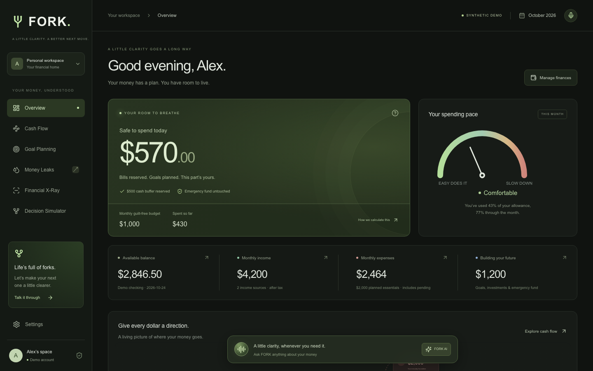

# FORK

**A little clarity. A better next move.**

FORK is a financial decision workspace built for HackPSU 2026 and the FNB Financial Confidence Challenge: help people make smarter financial decisions at the moments that matter most.



The core experience connects **information → understanding → confidence → action**: follow your income through interactive financial bubbles, understand your spending room, compare future decisions, and confirm changes to your plan with FORK AI.

## Run locally

Use Node.js 22.22+ (Node 24 LTS recommended) and npm.

```sh
npm ci
npm run dev
```

Open [FORK on localhost](http://127.0.0.1:3000). No credentials are needed for the synthetic demo. Every browser receives its own signed, HTTP-only demo-session cookie; the local server persists its financial plan in an ignored `.data/` file. There are no real accounts, purchases, or transfers. Local demo storage is for a single server process, not distributed hosting. Session cookies created without a configured signing secret become invalid after a server restart; set `SESSION_SECRET` for stable local sessions.

To configure integrations, copy `.env.example` to `.env.local`, fill values privately, and restart the server. `APP_BASE_URL` must match the exact browser origin used (for example `http://127.0.0.1:3000`). Never commit real environment files. `npm run db:migrate` reads shell environment variables; use `node --env-file=.env.local --import tsx scripts/migrate.ts` if your credentials are in `.env.local`.

## Working product

- Overview with explainable safe-to-spend, monthly allocation metrics, spending speedometer, obligations, goals, and recent activity.
- Animated React Flow diagram with draggable/editable nodes, zoom/pan, and a three-month allocation view.
- Goal creation, edits, deletion with confirmation, priorities, required contribution calculations, and budget updates.
- Protected emergency reserves, runway, configurable coverage target, and monthly contribution planning.
- Recurring-merchant detection, price increases, possible entertainment overlap, manual necessity review, false-positive exclusion, and goal acceleration estimates.
- Financial X-Ray upload/review UI; CSV imports work locally with validation and deduplication. Gemini-backed PDF/image extraction requires a key.
- Daily 90-day baseline/alternative balance graphs, purchase timing, income/savings/subscription scenarios, buffer warnings, and fixed-rate loan offer comparison.
- Persistent FORK assistant with deterministic read tools and signed, expiring, user/version-bound confirmation proposals. A limited local intent parser is explicitly labeled as demo mode when Gemini is absent.
- Shared Zustand state, backend-confirmed saves, stale-version conflict recovery, cross-tab refresh, JSON data export, and responsive layouts.
- Manual entries for income sources, bills, balances, allocations, and CSV transactions.

## Integrations: implemented vs. verified

| Provider         | Adapter implemented                                                                                                                          | Requires external setup / live verification                                                                                        |
| ---------------- | -------------------------------------------------------------------------------------------------------------------------------------------- | ---------------------------------------------------------------------------------------------------------------------------------- |
| Google Gemini    | Server-side structured intent routing and PDF/image extraction with Zod validation; finance answers come from deterministic tools            | API key, model access, extraction quality and live requests                                                                        |
| ElevenLabs       | Server-side signed WebSocket URL; React voice UI, microphone/mute, transcript and `askFork` client tool routed to the same proposal endpoint | API key, private agent, Gemini/agent configuration, client tool registration, browser microphone permission, real voice round trip |
| Tiger Data       | PostgreSQL through Drizzle/postgres, migration, tenant-scoped atomic snapshot writes, normalized analytics mirrors, seeded demo sessions     | A PostgreSQL connection, actual migration, live SQL isolation and persistence verification                                         |
| Auth0            | SDK v4 Proxy, login/callback/logout, authenticated identity, protected mode and isolated data                                                | Tenant credentials, callback allowlist and real signup/login/logout verification                                                   |
| Plaid            | Sandbox Link, public-token exchange, AES-256-GCM encrypted token storage, account balances, paginated transaction sync and deduplication     | Sandbox credentials, encryption key, PostgreSQL, configured Link environment, live sync validation                                 |
| Vercel           | Next.js production build and deployment instructions                                                                                         | Account/project authorization, environment configuration, migrations and live deployment                                           |
| GoDaddy Registry | Not integrated                                                                                                                               | Optional domain, eligibility and explicit approval for any expenditure                                                             |

No external sponsor integration has been live-verified without credentials. No sponsor eligibility or live URL is claimed. DEV Community is documentation only. No Cursor, Grok Bot, SpaceXSI, Solana, or Vultr integration is included.

## Financial calculation contract

All money is integer USD cents. Current plan: monthly net income minus essential allocations, debt, goal contributions, investments and emergency contributions equals the monthly guilt-free budget. Current-month discretionary transactions, including pending discretionary purchases, consume that budget.

Safe today is `max(0, min(remaining monthly allowance, checking balance − pending debits − planned bills through next payday − cash buffer))`. It is a conservative upper limit for a purchase today, not an amount to spend each day. Checking input means posted cash before pending debits. Expected income is not available cash. Bills on payday are reserved before same-day income. Emergency reserves are always separate. Dates roll forward in America/New_York; transaction dates are calendar dates. Multi-currency, refund/transfer reconciliation, and per-user time zones are not implemented.

The forecast starts with recorded cash minus pending debits, repeats scheduled income and essentials, deducts monthly allocations on the first, and assumes the planned daily average discretionary spending. It records a conservative pre-deposit low for bills on payday. Income changes arrive on the first income source’s payday. Subscription savings only begin next month. No investment returns, interest, taxes, fees, unexpected expenses, or future changes are invented. Loan comparisons assume fixed APR, equal payments, no fees, and rounded cents. They do not create debt records.

Goal savings and emergency reserves are entered balances, not implied bank subaccounts. A planning change never transfers funds. A CSV/document import adds history and spending evidence; it does not adjust cash balance. Recurring detection currently targets monthly payments (25–35 days); annual/weekly recurrence and comprehensive duplicate-service matching remain future improvements. Entertainment overlap is only a review hint, not proof of duplication or disuse.

## Database and authentication

1. Provision a free/sandbox Tiger Data PostgreSQL instance yourself and set `DATABASE_URL`.
2. Set `SESSION_SECRET` to at least 32 random characters. Generate locally; do not paste it in chat.
3. Run the migration using the command above. The application seeds each synthetic session on first access; authenticated accounts start empty.
4. Create an Auth0 **Regular Web Application** and set the four Auth0 variables. `AUTH0_DOMAIN` has no scheme.
5. Allow callback `APP_BASE_URL/auth/callback` and logout URL `APP_BASE_URL`. Use the exact production origin too.
6. Set `DEMO_MODE=false` to require login. With demo enabled, unauthenticated visitors use isolated synthetic accounts; authenticated users receive separate real/manual workspaces, never the demo snapshot.
7. All route handlers resolve identity server-side; callers cannot supply a tenant ID. Each query filters by that identity. Postgres snapshot row locks and optimistic versions prevent lost updates. Signed AI confirmations bind the action to user, version and expiry; replays fail on version conflict.

The canonical financial snapshot and normalized ledger mirrors commit together. The `monthly_spending` view supports user-filtered SQL category/month analytics. The UI currently calculates analytics from the same validated snapshot; it does not claim to query the SQL view. Categories and recurring payments are mirrored on saves. Scenarios have a migration; scenario persistence and a production migration history runner are not yet wired. Local demo action audit logs are not durable; database AI actions are logged. Database row-level security is not enabled: isolation is enforced by the scoped server repository and must be verified against a real database before handling real users.

## ElevenLabs agent setup

1. Create a private ElevenLabs conversational agent. Enable **Authentication / signed URLs** (not a public agent or domain allowlist). Choose a voice and keep the maximum conversation duration short.
2. Add a **Client** tool named exactly `askFork`. Add one required **String** parameter named exactly `message`, and enable **Wait for response**. Its description should say: "Send the user's exact financial question or requested plan change to FORK. Wait for FORK's reply and speak that reply."
3. Give the agent these instructions: "You are FORK's voice interface. For every question about this user's money, spending, goals, transactions, or requested plan change, call `askFork` with the user's exact request and wait for its reply. Never invent balances, prices, decisions, or successful writes. Speak FORK's result faithfully, including uncertainty. If the result proposes a change, tell the user to review and press Confirm change on screen; you cannot confirm it yourself. If the tool fails, say the answer is unavailable and ask the user to try the text assistant."
4. Create an ElevenLabs API key with only the permissions needed to request signed agent sessions and a conservative credit limit. Copy it privately; it is only shown in full once. In a terminal in this directory, run `node scripts/configure-elevenlabs.mjs <agent-id>` (or omit the ID to enter it at a second hidden prompt). Paste the API key at the hidden prompt and press Return. The script verifies a signed URL before saving both values to ignored `.env.local`. Restart FORK afterward. Never paste the key in chat or commit it.
5. In FORK, press **Start voice conversation**, grant microphone access in your browser, and ask a simple financial question. Confirm that the spoken answer matches the visible FORK reply. Test a proposed goal change and verify nothing changes until **Confirm change** is pressed.

The server signs each session URL; the browser receives no API key. `askFork` cannot confirm a proposal. Browser voice sessions end after five minutes to limit accidental usage. A live voice round trip and the silence fix were manually verified on October 25, 2026. The agent's **Take turn after silence** setting is disabled so it waits for user speech, and punctuation-only transcripts are hidden in FORK.

## Plaid Sandbox setup and limits

Configure Sandbox keys and a base64-encoded random 32-byte `TOKEN_ENCRYPTION_KEY` plus PostgreSQL. Connect through Settings. Tokens stay encrypted server-side. Use Sandbox test credentials inside Plaid Link, never FORK. Sync is manual and displays its timestamp; no webhook or automatic refresh guarantee is implemented. Only USD depository accounts are counted. Current balances are used before pending debits. Non-income credits and transfers are excluded pending explicit reconciliation support. Negative checking balances are clamped for the nonnegative cash model; overdraft support is not implemented. First sync replaces synthetic demo transactions while retaining the explicitly planned allocations. Review classifications after sync. Do not use this adapter for real banking until these limitations are addressed and live security tests pass.

## Validation

```sh
npm test
npm run typecheck
npm run build
npx playwright install chromium
npm run test:e2e
```

The production build uses Webpack because this host’s Turbopack build subprocess could not bind its internal port. An upstream Auth0 DPoP dynamic-import bundler warning may appear; DPoP is not enabled. See [IMPLEMENTATION_STATUS.md](IMPLEMENTATION_STATUS.md) for actual verification outcomes and remaining blockers. Automated E2E tests use fresh synthetic sessions. Unit tests do not substitute for live Auth0, banking or database isolation checks.

## Deploy to Vercel

Import this directory as a Next.js project, choose Node 24, use `npm ci` and `npm run build`, and configure the environment privately in Vercel. Set `APP_BASE_URL` to the final origin, `DATABASE_URL`, and a stable `SESSION_SECRET`. Migrate the database before first access. Demo file storage intentionally refuses Vercel because its filesystem is not durable. For authenticated mode also set Auth0 credentials and `DEMO_MODE=false`. Test actual callback/logout URLs, tenant isolation, imports and signed actions at the deployed origin. Keys can be left unset for optional Gemini/voice/Plaid features; those features explain their unavailable state. Deploying optional integrations can incur provider usage: no paid plan or billable action has been authorized or enabled here.

See [architecture](docs/ARCHITECTURE.md), [submission description](docs/DEVPOST.md), [demo script](docs/DEMO_SCRIPT.md), and [optional technical article](docs/DEV_COMMUNITY_ARTICLE.md).
