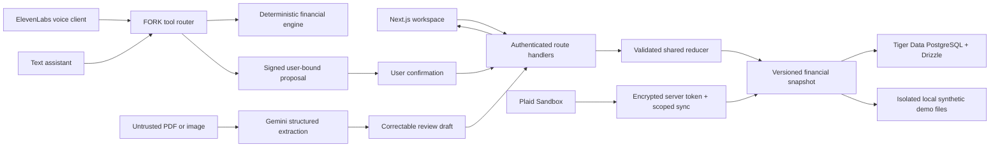

# Architecture

FORK uses a single validated `FinancialState` with integer cents. The browser renders that state through Zustand; every manual edit and confirmed assistant action goes through the same reducer and repository. A version conflict reloads authoritative state instead of silently overwriting another change.

## Modules

| Module                        | Responsibility                                                                               |
| ----------------------------- | -------------------------------------------------------------------------------------------- |
| `src/lib/model.ts`            | Zod schemas, cents, reducer and transaction deduplication                                    |
| `src/lib/finance.ts`          | Monthly affordability, cash timing, pace, goals, runway, recurrence and scenarios            |
| `src/lib/seed.ts`             | Internally consistent synthetic data                                                         |
| `src/lib/server/auth.ts`      | Auth0 identities, isolated signed demo sessions, proposal signatures and write-origin checks |
| `src/lib/server/store.ts`     | User-scoped reads and serialized/transactional versioned writes                              |
| `src/lib/server/assistant.ts` | Intent classification, deterministic tools, previews and confirmation verification           |
| `src/lib/server/plaid.ts`     | Sandbox client and AES-GCM token encryption                                                  |
| `src/lib/client-store.ts`     | Shared authoritative client state and cross-tab notifications                                |
| `src/components/*`            | Responsive product sections and accessible Radix dialogs                                     |

## Trust boundaries

The API never accepts a user ID from the browser. Gemini only selects a validated tool or proposes draft extraction. Financial answers are rendered from deterministic calculations. The assistant cannot bypass confirmation: a signed token expires after ten minutes and becomes stale after a state change. Document output remains untrusted until validated and manually confirmed. External errors avoid returning provider tokens. Server credentials never use `NEXT_PUBLIC_`.

The PostgreSQL repository locks a user’s snapshot for writes. Normalized transaction, income, account, goal, budget and emergency rows are mirrors used for future SQL analytics. Local persistence is a single-process fallback for synthetic data only. Authenticated workspaces and Vercel hosting require PostgreSQL. TLS is required for PostgreSQL connections.

## Remaining production work

Live provider tests; distributed throttling and abuse controls for billable endpoints; database RLS defense in depth; retention/deletion and data recovery flows; refund/transfer and overdraft support; currency/timezone preferences; scheduled banking webhooks; durable local audit events; tracing/monitoring; normalized recurring/category/scenario persistence. These are explicit limitations, not represented as completed integrations.
